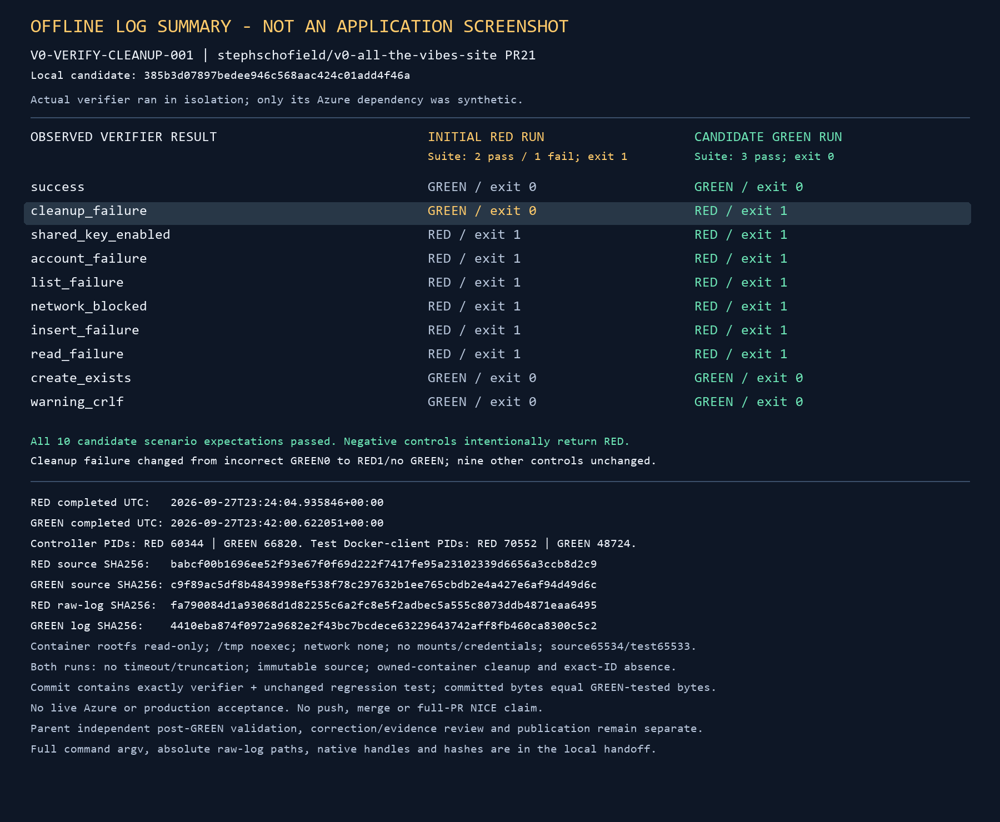

# Maintainer storage cleanup regression

Scope: V0-VERIFY-CLEANUP-001 in PR21. Source commit `385b3d07897bedee946c568aac424c01add4f46a` adds one error-count
increment after failed probe deletion. It does not change authentication, network
controls, production variables, or any other failure branch.

## Actual RED / GREEN

| Run | Test methods | Scenarios | Result |
| --- | --- | --- | --- |
| Initial RED | 2 pass, 1 intended failure | 10 | Suite exit1; failed cleanup incorrectly returned GREEN0 |
| Candidate GREEN | 3 pass, 0 failures | 10 | Suite exit0; failed cleanup correctly returns RED1/no GREEN |

The same regression test bytes were used in both runs. The nine other control
scenarios retained their recorded outputs and exit behavior. Negative verifier
scenarios intentionally return RED; their tests pass when that happens.

- [Complete original RED log](red.log)
- [Complete original GREEN log](green.log)
- [Exact UTC times, commands, source hashes and isolation](evidence.json)
- [Synthetic staged variables](synthetic-azure-vars.sh.txt)



## Execution boundary and reproduction

The actual Bash verifier ran in the pinned isolated Python image recorded in
`evidence.json`. Only its external Azure dependency was a deterministic sourced
Bash function. No real Azure CLI, resources, credentials or network were used.
The protected staged tree contained the verifier, regression test and exact
synthetic variables; it did not contain production `azure-vars.sh`.

The in-container test command was:

```text
/usr/local/bin/python3 -I -B /tmp/v0-storage-lane/infra/tests/test_verify_maintainer_storage.py
```

Reproduction requires the same separately qualified secret-free source65534 /
test65533 immutable staging boundary. The test deliberately rejects other users
or non-synthetic variables. Do not run the repository verifier against production
to reproduce this bug. No package installation or permission relaxation is needed.

The source commit records exactly the tested verifier/test bytes. This later
evidence-only package is not another test run. The image is clearly labeled an
offline summary; full original logs are included unchanged.

## Remaining gates

This is not live Azure/network/managed-identity acceptance, whole-PR NICE or merge
approval. Fresh correction/evidence review, normal publication and independent
producer verification are still required; unrelated full-PR gates remain intact.
